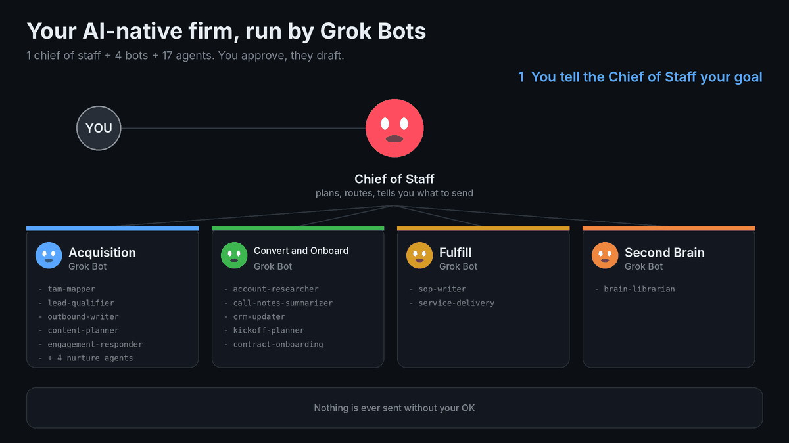
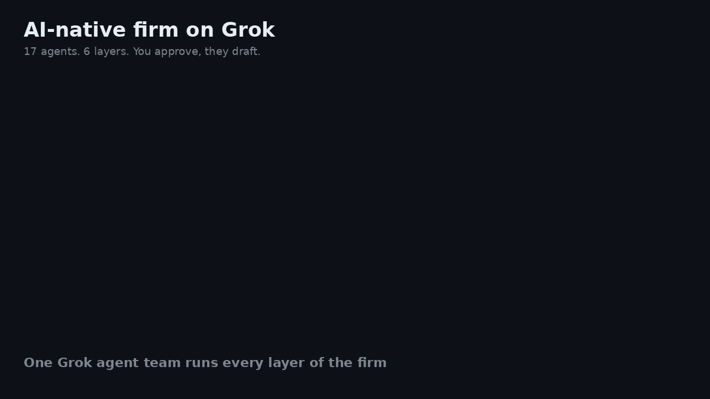

# grok-ai-native-firm

A Grok-powered agent team that runs the 6 layers of an AI-native firm: sell the outcome at an agency price, run it with software-like costs.

Based on the 6-layer setup Tim Scheuer shared, inspired by Sequoia's "next $1T idea is the AI-native firm."



## Two ways to run it

| | Grok Bots (no code) | Python CLI |
|---|---|---|
| Where it runs | The Grok app (grok.com, Mac and mobile), in the cloud | Your own computer, terminal |
| Needs | A Grok account with Grok Bot | Python + an xAI API key with credits |
| You talk to it | By chatting: Chief of Staff first | `python run.py ...` |
| Tools (Apollo, HubSpot, files) | Gmail, Calendar, Drive and other app connectors | Built-in actions, drafts saved to `outbox/` |
| Start here | [Grok Bots setup](#run-it-as-grok-bots-no-terminal) | [Setup](#setup) |

```
1 Acquisition -> 2 Nurture -> 3 Convert -> 4 Onboard -> 5 Fulfill
                         \________ 6 Second brain (everything filed + linked) ________/
```

## Agents (17)

| Layer | Agents | What they do |
|---|---|---|
| 1 Acquisition | tam-mapper, lead-qualifier, outbound-writer, content-planner, engagement-responder | Map TAM, build/qualify lead list (Apollo), multi-channel outbound, LinkedIn/X content, DM people who engage |
| 2 Nurture | lead-magnet-builder, webinar-planner, newsletter-writer, lead-reactivator | Lead magnets, bi-weekly webinars, newsletter, revive stale leads |
| 3 Convert | account-researcher, call-notes-summarizer, crm-updater | Pre-call brief, notetaker output to summary, CRM update (HubSpot) |
| 4 Onboard | kickoff-planner, contract-onboarding | Kickoff plan, contract outline + welcome flow |
| 5 Fulfill | sop-writer, service-delivery | Write SOPs, deliver the one productized service by them |
| 6 Second brain | brain-librarian | File, link ([[wiki-links]]) and index every post, lead, call, client and SOP |

## Actions (what agents can do)

`brain_write` `brain_read` `brain_search` `brain_backlinks` `lead_add` `lead_list` `draft_message` `apollo_people_search` `hubspot_create_contact`

Safety by design: agents **never send anything**. Messages are saved to `outbox/` as drafts for you to approve. Every run is filed in `brain/runs/`.

## Run it as Grok Bots (no terminal)

1 chief of staff + 4 worker bots, built from the same 17 agents. Prompts are ready to paste in [`grok-bots/`](grok-bots/).

| Bot | Agents inside | File |
|---|---|---|
| Chief of Staff | none. You message it first. It plans and tells you which bot and agent to use | `0-chief-of-staff.md` |
| Acquisition | 5 acquisition + 4 nurture agents | `1-acquisition.md` |
| Convert and Onboard | 3 convert + 2 onboard agents | `2-convert-onboard.md` |
| Fulfill | sop-writer, service-delivery | `3-fulfill.md` |
| Second Brain | brain-librarian | `4-second-brain.md` |

1. In the Grok app, create a bot for each file (name it like the table).
2. Send the file's text as its first message: "Save the following as your standing role and remember it permanently."
3. Paste your own company details where it says `(paste your company.yaml here)`.
4. Message **Chief of Staff** with a goal. It replies with a plan and the exact message to send the next bot, starting with `agent: <name>`.

You paste its message into the right bot, then paste the result back and ask "what next". Bots work from what you give them; they don't see your live CRM, so they give search criteria instead of inventing names. Everything stays a draft until you approve it.

Per-layer prompts (one per layer, if you prefer 6 smaller projects) are in [`grok-app/`](grok-app/).
Regenerate both after editing an agent: `python tools/build_grok_app.py`

## Setup (Python CLI)

```bash
git clone https://github.com/rakeshSabbathi/grok-ai-native-firm-rakesh.git
cd grok-ai-native-firm-rakesh
pip install -r requirements.txt
cp .env.example .env        # add XAI_API_KEY (console.x.ai); Apollo/HubSpot keys optional
```

Edit `config/company.yaml` with your offer, ICP and voice. Every agent reads it.

## Use

```bash
python run.py list
python run.py agent tam-mapper "AI-native RevOps agency for D2C brands in India"
python run.py workflow acquisition "AI-native RevOps agency for D2C brands in India"
python run.py workflow convert "Acme Pvt Ltd, call notes: ..."
pytest -q                   # offline sanity checks
```

Workflows live in `workflows/workflows.yaml`. Add a step or a new workflow by editing YAML. Add an agent by dropping a markdown file in `agents/<layer>/` with `name`, `actions` and a prompt.

### Under the hood



## Structure

```
agents/      one markdown spec per agent, grouped by layer
grok-bots/   paste-ready prompts: chief of staff + 4 bots
grok-app/    paste-ready prompts: one per layer
core/        grok.py (xAI client), agent.py (runner), actions.py (tools)
workflows/   YAML pipelines per layer
brain/       second brain: leads, calls, clients, sops, content, runs
config/      company.yaml
outbox/      drafts waiting for your approval
```

## Notes

- Grok runs through xAI's OpenAI-compatible API (`https://api.x.ai/v1`). Change the model with `GROK_MODEL`.
- Only the Apollo and HubSpot actions call outside services, and only if you set their keys.
- Notetakers (Granola, Fathom, Fireflies), Zoom/Meet and contract/payment tools aren't wired in yet. Paste their output into the `convert` and `onboard` workflows.

MIT License
